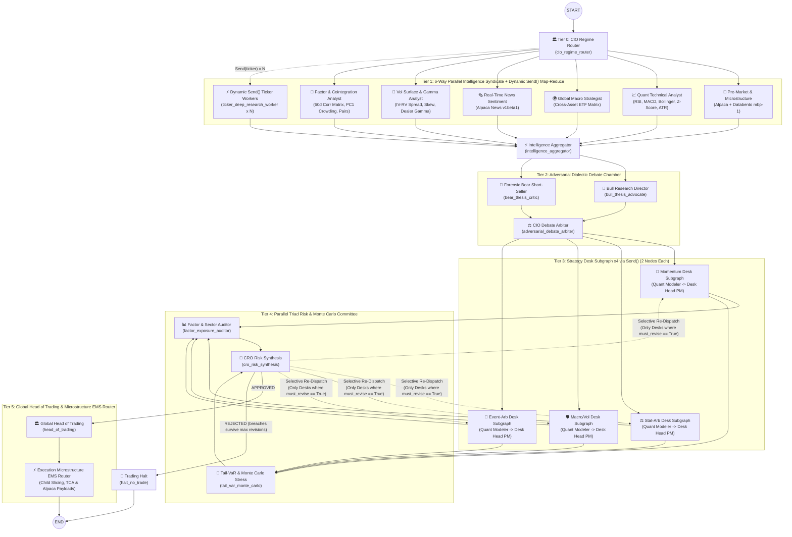

# 24-Node Hierarchical Multi-Strategy Hedge Fund in LangGraph

An institutional **24-Node Hierarchical Multi-Strategy Hedge Fund** built in **LangGraph**, powered by **OpenAI (`gpt-4o`)**, **Alpaca Markets Real-Time Data & Breaking News API**, and **Databento L1 Orderbook Microstructure (`DBEQ.BASIC` `mbp-1`)**, configured for **LangGraph Studio**.

---

## 🏗️ Advanced Agentic Architecture Patterns Implemented

1. **Dynamic Map-Reduce Fan-Out (`Send()` API)**:
   - [`fan_out_from_cio_router`](src/trading_desk/graph.py) simultaneously triggers **6 parallel Intelligence Syndicate specialists** AND dynamically spawns **N parallel [`ticker_deep_research_worker`](src/trading_desk/graph.py) instances via `Send()`** for single-ticker deep microstructure/technical dossier generation, converging at [`intelligence_aggregator_node`](src/trading_desk/graph.py).
2. **Adversarial Dialectic Debate & Arbiter Chamber**:
   - [`bull_thesis_advocate_node`](src/trading_desk/graph.py) (Bullish Growth Director) and [`bear_thesis_critic_node`](src/trading_desk/graph.py) (Forensic Short-Seller & Red-Team Critic) argue opposing cases in parallel before [`adversarial_debate_arbiter_node`](src/trading_desk/graph.py) synthesizes the winning directional tilt and desk capital weights.
3. **One Compiled Strategy Desk Subgraph, Dispatched per Desk via `Send()`**:
   - [`build_strategy_desk_subgraph`](src/trading_desk/graph.py) compiles a single 2-node `StateGraph` that is run once per desk (`MOMENTUM_DESK`, `STAT_ARB_DESK`, `MACRO_VOL_DESK`, `EVENT_ARB_DESK`). The desk is chosen by `desk_name` in the `Send()` payload ([`dispatch_strategy_desks`](src/trading_desk/graph.py)), so a revision round re-runs only the flagged desks with no extra nodes or edges.
     - **`desk_quant_modeler`**: Runs mathematical signal selection & derivatives/pair structuring (`DeskQuantModelOutput`). The draft is private to the subgraph.
     - **`desk_head_pm`**: Reviews quant signals & CRO directives and signs off on the desk mandate (`DeskMandateProposal`).
   - The subgraph takes a small `DeskInput` (`desk_name`, `revision_count`, prebuilt `context`) and returns a `DeskOutput` (`desk_proposals`, `messages`). It does not mirror the parent state.
4. **Parallel Triad Risk Committee & Selective Desk Re-Dispatch Loop**:
   - [`factor_exposure_auditor_node`](src/trading_desk/graph.py) and [`tail_var_monte_carlo_node`](src/trading_desk/graph.py) run in parallel across the combined 4-desk book before converging at [`cro_risk_synthesis_node`](src/trading_desk/graph.py).
   - The deterministic risk engine, not the LLM, sets the CRO status. If breaches occur (`REVISE_DESKS`), [`route_after_cro_synthesis`](src/trading_desk/graph.py) selectively re-dispatches **only** the desks flagged with `must_revise=True`. Breaches that survive the last revision round are `REJECTED` and route to `halt_no_trade`: the gate fails closed and nothing reaches the Head of Trading.
5. **Two-Stage Execution Hierarchy (Head of Trading -> Microstructure EMS Router)**:
   - [`head_of_trading_node`](src/trading_desk/graph.py) issues the master capital allocation and parent execution tickets.
   - [`execution_microstructure_router_node`](src/trading_desk/graph.py) uses Databento L1 spread & orderbook imbalance to slice parent tickets into child orders across Dark Pools, IEX D-Limit, and Lit venues, estimates TCA slippage in bps/USD, and generates ready-to-submit Alpaca `v2/orders` JSON payloads.

---

## 🗺️ 6-Tier, 24-Node Topology Diagram



---

## 🧱 State Design

[`TradingDeskState`](src/trading_desk/state.py) holds typed Pydantic objects, not dumped dicts. Only channels that parallel branches write to the same key use the `merge_dicts` reducer (`intel_reports`, `ticker_dossiers`, `adversarial_debate`, `desk_proposals`, `risk_sub_reports`); the rest are plain last-value channels. The desk subgraph's working state (`DeskState`, including the quant draft) stays private to it.

The Decisions API answers are stored on the models as `openai_decisions_api`. That field is hidden from the LLM's structured-output schema.

Risk numbers live in one place, [`limits.py`](src/trading_desk/limits.py): `MANDATE_LIMITS` are the hard caps the risk engine enforces, and `REVISION_TARGETS` are the tighter numbers desks are told to meet (and the revision clamp enforces) on a revision round. The engine, clamp, prompts and CRO messages all read from it.

Because the state holds Pydantic models, `langgraph.json` allowlists them under `serde.allowed_msgpack_modules`. Add a new top-level state model there if you add one.

---

## 🚀 Quick Start

### 1. Open in LangGraph Studio
The local LangGraph Studio dev server is running on port `2024`:
- **LangGraph Studio UI**: [https://smith.langchain.com/studio/?baseUrl=http://127.0.0.1:2024](https://smith.langchain.com/studio/?baseUrl=http://127.0.0.1:2024)
- To restart manually:
  ```bash
  uv run langgraph dev
  ```

### 2. Run End-to-End from CLI
```bash
uv run python run_example.py
```

### 3. Run the Offline Wiring Tests
LLMs, market-data tools and Decisions-API calls are stubbed, so no keys, network or cost are needed. The real risk engine is used.
```bash
uv run python -m unittest discover -s tests -v
```

---

## 🎬 Walkthrough Video

[`docs/demo/video-source/`](docs/demo/video-source/README.md) holds everything needed to make a 3:40 narrated walkthrough of how this graph executes: a live-graph visualiser that animates the real LangGraph event stream (fan-out, reducers, the desk subgraph, the revision loop, the CRO gate), a recorder, a narration pipeline with a round-trip transcription check, and word-timed subtitles. Scenes C to G and I are a recording of one real run; scene H (the fail-closed branch) is labelled on screen as an illustration because that path did not fire. The rendered `.mp4`, `.srt`, `.vtt` and transcript are written to `docs/demo/`.
