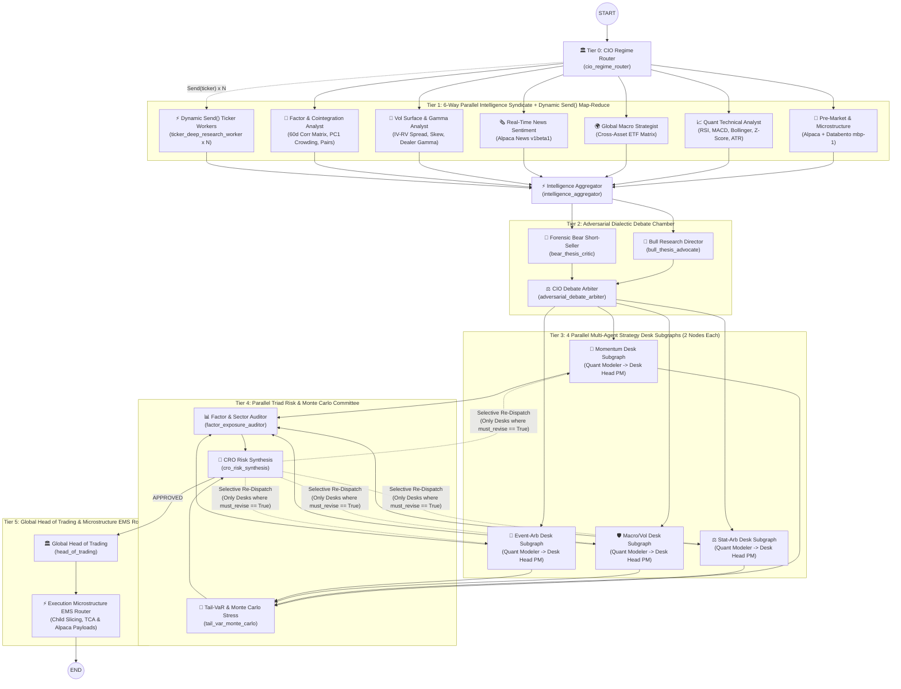

# 24-Node Hierarchical Multi-Strategy Hedge Fund in LangGraph

An institutional **24-Node Hierarchical Multi-Strategy Hedge Fund** built in **LangGraph**, powered by **OpenAI (`gpt-4o`)**, **Alpaca Markets Real-Time Data & Breaking News API**, and **Databento L1 Orderbook Microstructure (`DBEQ.BASIC` `mbp-1`)**, configured for **LangGraph Studio**.

---

## 🏗️ Advanced Agentic Architecture Patterns Implemented

1. **Dynamic Map-Reduce Fan-Out (`Send()` API)**:
   - [`fan_out_from_cio_router`](file:///Users/garyamorris/Developer/repos/complex-langraph/src/trading_desk/graph.py#L195-L212) simultaneously triggers **6 parallel Intelligence Syndicate specialists** AND dynamically spawns **N parallel [`ticker_deep_research_worker`](file:///Users/garyamorris/Developer/repos/complex-langraph/src/trading_desk/graph.py#L430-L458) instances via `Send()`** for single-ticker deep microstructure/technical dossier generation, converging at [`intelligence_aggregator_node`](file:///Users/garyamorris/Developer/repos/complex-langraph/src/trading_desk/graph.py#L461-L479).
2. **Adversarial Dialectic Debate & Arbiter Chamber**:
   - [`bull_thesis_advocate_node`](file:///Users/garyamorris/Developer/repos/complex-langraph/src/trading_desk/graph.py#L492-L511) (Bullish Growth Director) and [`bear_thesis_critic_node`](file:///Users/garyamorris/Developer/repos/complex-langraph/src/trading_desk/graph.py#L514-L533) (Forensic Short-Seller & Red-Team Critic) argue opposing cases in parallel before [`adversarial_debate_arbiter_node`](file:///Users/garyamorris/Developer/repos/complex-langraph/src/trading_desk/graph.py#L536-L567) synthesizes the winning directional tilt and desk capital weights.
3. **Compiled Multi-Agent Strategy Desk Subgraphs (`4 Parallel Subgraphs = 8 Internal Nodes`)**:
   - Built via [`create_strategy_desk_subgraph`](file:///Users/garyamorris/Developer/repos/complex-langraph/src/trading_desk/graph.py#L620-L702), each of the 4 desks (`MOMENTUM_DESK`, `STAT_ARB_DESK`, `MACRO_VOL_DESK`, `EVENT_ARB_DESK`) is a compiled `StateGraph` subgraph containing two internal agents:
     - **`desk_quant_modeler`**: Runs mathematical signal selection & derivatives/pair structuring (`DeskQuantModelOutput`).
     - **`desk_head_pm`**: Reviews quant signals & CRO directives and signs off on the desk mandate (`DeskMandateProposal`).
4. **Parallel Triad Risk Committee & Selective Desk Re-Dispatch Loop**:
   - [`factor_exposure_auditor_node`](file:///Users/garyamorris/Developer/repos/complex-langraph/src/trading_desk/graph.py#L725-L751) and [`tail_var_monte_carlo_node`](file:///Users/garyamorris/Developer/repos/complex-langraph/src/trading_desk/graph.py#L754-L779) run in parallel across the combined 4-desk book before converging at [`cro_risk_synthesis_node`](file:///Users/garyamorris/Developer/repos/complex-langraph/src/trading_desk/graph.py#L782-L867).
   - If mandate breaches occur (`REVISE_DESKS`), [`route_after_cro_synthesis`](file:///Users/garyamorris/Developer/repos/complex-langraph/src/trading_desk/graph.py#L870-L886) selectively re-dispatches **only** the specific Strategy Desk Subgraphs flagged with `must_revise=True`.
5. **Two-Stage Execution Hierarchy (Head of Trading -> Microstructure EMS Router)**:
   - [`head_of_trading_node`](file:///Users/garyamorris/Developer/repos/complex-langraph/src/trading_desk/graph.py#L893-L936) issues the master capital allocation and parent execution tickets.
   - [`execution_microstructure_router_node`](file:///Users/garyamorris/Developer/repos/complex-langraph/src/trading_desk/graph.py#L939-L983) uses Databento L1 spread & orderbook imbalance to slice parent tickets into child orders across Dark Pools, IEX D-Limit, and Lit venues, estimates TCA slippage in bps/USD, and generates ready-to-submit Alpaca `v2/orders` JSON payloads.

---

## 🗺️ 6-Tier, 24-Node Topology Diagram



---

## 🚀 Quick Start

### 1. Open in LangGraph Studio
The local LangGraph Studio dev server is running on port `2024`:
- **LangGraph Studio UI**: [https://smith.langchain.com/studio/?baseUrl=http://127.0.0.1:2024](https://smith.langchain.com/studio/?baseUrl=http://127.0.0.1:2024)
- To restart manually:
  ```bash
  uv run langgraph dev
  ```

### 2. Run End-to-End from CLI
```bash
uv run python run_example.py
```
